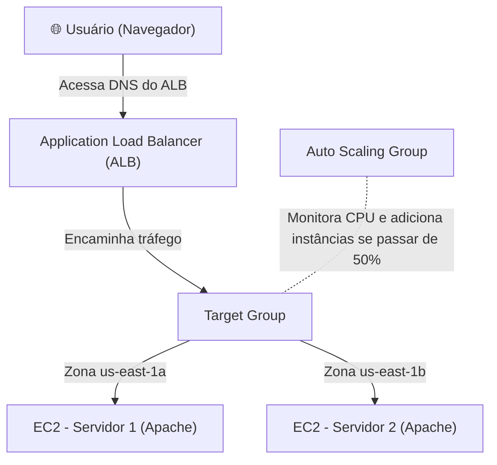

# Lab AWS - Balanceamento de Carga e Auto Scaling (ALB + ASG)

Prática realizada durante a formação **AWS re/Start (Escola da Nuvem)** com foco em alta disponibilidade e escalabilidade automática na nuvem.

Toda a arquitetura foi configurada diretamente pelo **Console da AWS**, utilizando apenas um script simples de User Data no Linux para inicializar o servidor web Apache.

---

## 🏛️ O que foi construído

Distribuir requisições de usuários entre servidores em Zonas de Disponibilidade (AZs) diferentes para garantir que, se um servidor ou data center falhar, a aplicação continue no ar sem interrupção.



---

## 🛠️ Passo a Passo no Console da AWS

### 1. Criar os Security Groups (Console EC2)
- **SG do Load Balancer (`sg-alb`):**
  - Entrada: Permitir HTTP (porta 80) de qualquer lugar (`0.0.0.0/0`).
- **SG das Instâncias EC2 (`sg-web`):**
  - Entrada: Permitir HTTP (porta 80) **somente vindo do Security Group do Load Balancer (`sg-alb`)**. Isso garante que ninguém acesse os servidores diretamente pelo IP, apenas através do Load Balancer.

### 2. Criar o Launch Template (Console EC2)
- Nome: `template-servidor-web`
- AMI: **Amazon Linux 2023** (gratuito)
- Tipo de instância: `t2.micro` ou `t3.micro`
- Security Group: selecionar o `sg-web`
- No campo **Dados do Usuário (User Data)** (abaixo em *Detalhes Avançados*), foi inserido o script bash para instalar o Apache automaticamente na inicialização:

```bash
#!/bin/bash
# Atualiza os pacotes e instala o servidor Apache
dnf update -y
dnf install -y httpd

# Inicia e habilita o Apache para iniciar no boot
systemctl start httpd
systemctl enable httpd

# Cria uma página simples mostrando o IP e a Zona de Disponibilidade
TOKEN=$(curl -s -X PUT "http://169.254.169.254/latest/api/token" -H "X-aws-ec2-metadata-token-ttl-seconds: 21600")
AZ=$(curl -s -H "X-aws-ec2-metadata-token: $TOKEN" http://169.254.169.254/latest/meta-data/placement/availability-zone)
IP=$(curl -s -H "X-aws-ec2-metadata-token: $TOKEN" http://169.254.169.254/latest/meta-data/local-ipv4)

echo "<h1>Servidor Web Ativo</h1><p>Zona: $AZ</p><p>IP Interno: $IP</p>" > /var/www/html/index.html
```

### 3. Criar o Target Group (Console EC2 > Target Groups)
- Tipo de destino: **Instâncias**
- Protocolo: HTTP porta 80
- Caminho de verificação de integridade (Health Check): `/`

### 4. Criar o Application Load Balancer (Console EC2 > Load Balancers)
- Tipo: **Application Load Balancer (ALB)**
- Esquema: Voltado para a Internet (Internet-facing)
- Selecionar pelo menos 2 Zonas de Disponibilidade (ex: `us-east-1a` e `us-east-1b`)
- Security Group: `sg-alb`
- Listener: HTTP na porta 80 encaminhando para o Target Group criado.

### 5. Criar o Auto Scaling Group (Console EC2 > Auto Scaling Groups)
- Modelo de inicialização: selecionar o `template-servidor-web`
- Selecionar as mesmas subnets do Load Balancer.
- Anexar a um balanceador de carga existente: selecionar o Target Group.
- Tamanho do grupo:
  - Capacidade Mínima: **2**
  - Capacidade Desejada: **2**
  - Capacidade Máxima: **4**
- Política de dimensionamento automático: **Target Tracking** com meta de utilização média de CPU em **50%**.

---

## 🧪 Como Testar e Validar

1. Copie o endereço DNS do Load Balancer (ex: `meu-alb-12345.us-east-1.elb.amazonaws.com`).
2. Cole no navegador: a página irá carregar mostrando a Zona (ex: `us-east-1a`).
3. Atualize a página com `F5` várias vezes: você verá o Load Balancer alternando as requisições para a outra Zona (`us-east-1b`).
4. **Teste de falha:** Finalize manualmente uma instância EC2 pelo console. O Auto Scaling detecta a falha e cria automaticamente um novo servidor em poucos minutos para manter as 2 instâncias ativas.

---

## 🧹 Limpeza de Recursos (Teardown)
Para não ter custos na conta AWS após o lab:
1. Excluir o **Auto Scaling Group** (isso finaliza as instâncias EC2 automaticamente).
2. Excluir o **Application Load Balancer**.
3. Excluir o **Target Group**.
4. Excluir o **Launch Template** e os **Security Groups**.
